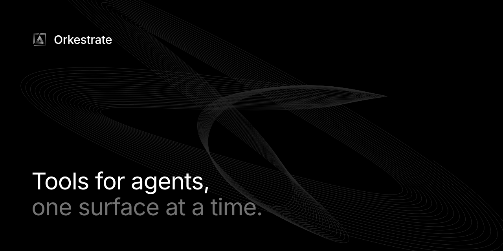

<p align="center">
  
</p>

Orkestrate builds tools that let AI agents work wherever software runs, one
surface at a time. The Web comes first.

### [agent-webmcp](https://github.com/orkestrate-dot-space/agent-webmcp)

Your agent is clicking through pages that already have typed tools.
agent-webmcp tells it which ones before it opens them, and the browser
driver it already uses does the rest. CLI and MCP server, MIT.

```console
$ curl -fsSL https://web.orkestrate.space/webmcp/install | bash   # Linux, macOS
$ npm i -g @orkestrate/agent-webmcp                               # any OS
$ agent-webmcp setup
```

- [Docs](https://web.orkestrate.space/webmcp)
- [Directory of WebMCP sites](https://web.orkestrate.space/webmcp/sites), where
  site owners can add theirs
- Next, in 0.3: `call` and a registry

[orkestrate.space](https://orkestrate.space) · support@orkestrate.space
